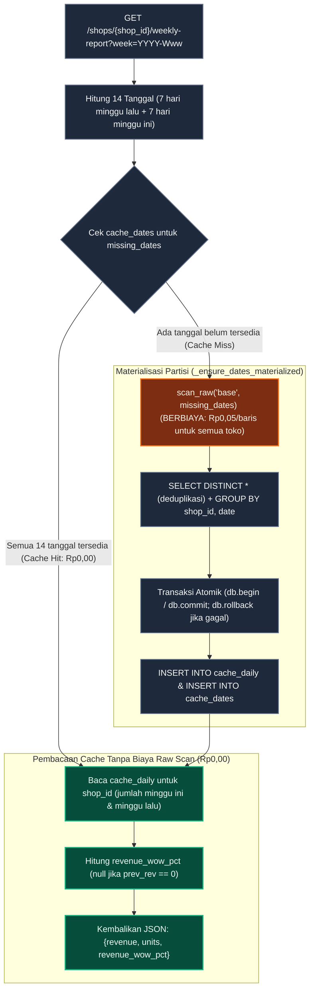
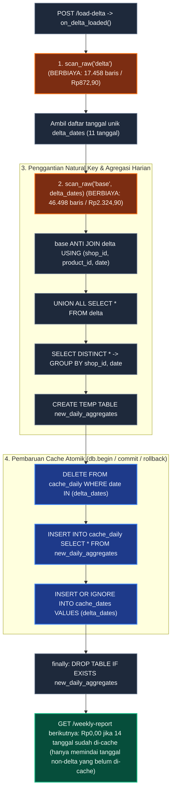
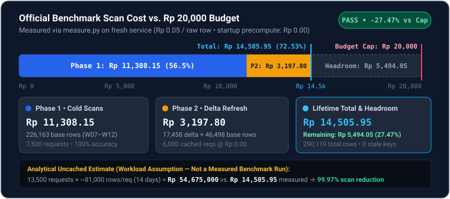

# Nesra Scale — Layanan Laporan Mingguan & Cache Hemat Biaya

Implementasi layanan laporan mingguan (*weekly report*) berbasis **FastAPI** dan **DuckDB** yang menekan biaya pemindaian data mentah (`Rp0,05/baris`) melalui **agregat harian per toko (*daily aggregate*)**, **materialisasi sesuai permintaan (*lazy materialization*)**, dan **pembaruan *delta* secara atomik**.

---

## 1. Ringkasan Solusi dan Hasil Utama

Pada arsitektur gudang data analitis seperti BigQuery, setiap pemindaian tabel mentah melalui `scan_raw(source, dates)` mengenakan biaya `Rp0,05` untuk **seluruh baris pada tanggal yang disentuh di semua 500 toko**, meskipun laporan hanya diminta untuk satu toko. Memindai seluruh data 90 hari saat *startup* akan langsung menghabiskan `Rp25.810,65` (`516.213` baris) dan melampaui batas anggaran `Rp20.000` sebelum melayani satu pun permintaan.

Solusi pada [`app/reports.py`](app/reports.py) menerapkan tiga strategi utama:
1. **Materialisasi sesuai permintaan (*lazy materialization*):** Sistem hanya memindai dan mengolah tanggal yang belum tersedia di dalam cache ketika laporan diminta.
2. **Penyimpanan agregat harian (*daily aggregate*):** Cache di DuckDB hanya menyimpan ringkasan total per toko per tanggal (`cache_daily`), bukan salinan baris produk mentah. Sekali suatu tanggal dipindai, hasilnya dapat digunakan oleh seluruh 500 toko tanpa pemindaian ulang.
3. **Pembaruan *delta* terarah (*targeted invalidation*):** Saat `POST /load-delta` dipanggil, hanya tanggal-tanggal yang terdapat di dalam batch `delta` yang dipindai ulang dan diperbarui dalam satu transaksi atomik.

| Metrik Evaluasi | Hasil Resmi `measure.py` | Target Nesra |
| :--- | :--- | :--- |
| **Akurasi Sebelum Delta** | **100,00%** (`7.422 / 7.422` terverifikasi; `0` error skema/numerik) | 100% sesuai |
| **Akurasi Sesudah Delta** | **100,00%** (`5.943 / 5.943` terverifikasi; `0` *stale key*) | 100% sesuai, 0 basi |
| **Total Biaya Pemindaian** | **Rp14.505,95** (`290.119` baris; hemat `Rp5.494,05` atau `27,47%` di bawah batas) | `< Rp20.000` |
| **Biaya Saat Startup** | **Rp0,00** (`0` baris dipindai saat inisialisasi layanan) | Tanpa *full scan* awal |

---

## 2. Arsitektur dan Mekanisme Cache

Saat layanan dijalankan, `startup()` hanya membuat dua tabel ringan di DuckDB tanpa memindai data mentah:
- **`cache_daily(shop_id, date, revenue, units)`** — `PRIMARY KEY (shop_id, date)`. Menyimpan total pendapatan dan unit terjual per toko per hari (`BIGINT`). Detail level produk (`product_id`, `category`, `ad_spend`, dll.) tidak pernah disimpan di cache.
- **`cache_dates(date)`** — `PRIMARY KEY (date)`. Mencatat tanggal kalender yang sudah dimaterialisasi ke dalam `cache_daily` (termasuk tanggal yang tidak memiliki baris transaksi agar tidak dipindai berulang).

Setiap permintaan `weekly_report()` membutuhkan rentang 14 hari (7 hari minggu yang diminta + 7 hari minggu sebelumnya untuk menghitung **WoW** atau *Week-over-Week*, yaitu persentase perubahan pendapatan dibanding minggu lalu). Fungsi `_ensure_dates_materialized()` memeriksa `cache_dates`:
- ***Cache hit*** (semua tanggal sudah ada di `cache_dates`): langsung membaca `cache_daily` tanpa biaya pemindaian (`Rp0,00`).
- ***Cache miss*** (ada tanggal yang belum tersedia): hanya tanggal yang belum ada (`missing_dates`) yang dipindai satu kali melalui `scan_raw("base", missing_dates)`.



---

## 3. Pembaruan Delta dan Konsistensi WoW

Secara umum cache bekerja secara *on-demand* (diproses saat ada request laporan). Pengecualiannya adalah pembaruan **delta**: sesuai kontrak `POST /load-delta`, fungsi `on_delta_loaded()` memproses pembaruan secara sinkron saat endpoint tersebut dipanggil agar seluruh laporan langsung mutakhir ketika respons dikembalikan:

1. **Identifikasi tanggal terdampak:** Memindai `scan_raw("delta")` dan mengambil daftar tanggal unik (`delta_dates`, sebanyak 11 tanggal).
2. **Pembacaan `base` terbatas:** Memindai `scan_raw("base", delta_dates)` khusus untuk 11 tanggal tersebut.
3. **Penggantian berbasis *natural key* & deduplikasi:** Baris `base` yang memiliki pasangan `(shop_id, product_id, date)` di `delta` digantikan menggunakan operasi `ANTI JOIN` diikuti `UNION ALL`, lalu dideduplikasi dengan `SELECT DISTINCT *` dan diagregasi per `(shop_id, date)` ke tabel sementara `new_daily_aggregates`.
4. **Transaksi atomik:** Di dalam blok `db.begin()` / `db.commit()` (dengan `db.rollback()` jika terjadi kegagalan), baris lama pada `delta_dates` dihapus dari `cache_daily`, agregat baru dimasukkan, dan `delta_dates` dicatat ke `cache_dates`.



### Contoh Nyata: Koreksi Historis `2025-W10` yang Memperbarui WoW `2025-W11`
Pada `delta.csv.gz`, produk `PRD50443267` milik toko `SHP141660` pada tanggal **`2025-03-07` (`2025-W10`)** dikoreksi dari `revenue = 540.000` (`3` unit) menjadi `revenue = 360.000` (`2` unit). Karena `weekly_report()` selalu menjumlahkan `cache_daily` untuk minggu berjalan dan minggu sebelumnya, pembaruan tanggal `2025-03-07` di `cache_daily` otomatis memperbarui pendapatan `2025-W10` **sekaligus** nilai `revenue_wow_pct` pada `2025-W11`:

| Laporan (`SHP141660`) | Sebelum Delta | Sesudah Delta | Penjelasan Perubahan |
| :--- | ---: | ---: | :--- |
| **`2025-W09`** (minggu tidak terdampak) | `Rp213.814.000` (`-51,61%` WoW) | `Rp213.814.000` (`-51,61%` WoW) | Tanggal `2025-02-17..03-02` tidak ada di `delta_dates`; tetap dilayani dari cache (`Rp0,00`). |
| **`2025-W10`** (memuat `2025-03-07`) | `Rp429.524.900` (`1.819` unit) | `Rp429.344.900` (`1.818` unit) | Agregat harian `2025-03-07` berkurang `Rp180.000` dan `1` unit. |
| **`2025-W11`** (minggu berikutnya) | `Rp284.327.800` (**`-33,80%`** WoW) | `Rp284.327.800` (**`-33,78%`** WoW) | Pendapatan W11 tetap, tetapi pembanding minggu lalu (`W10`) di `cache_daily` telah diperbarui. |
| **`2025-W12`** (minggu parsial → penuh) | `Rp493.166.800` (`4` hari) | `Rp869.744.300` (`7` hari, `+205,89%` WoW) | Delta menambahkan data tanggal `2025-03-21..23` (`17.446` baris baru). |

---

## 4. Hasil Benchmark dan Efisiensi Biaya



### Output Asli `measure.py` (Layanan Baru / Fresh Service)
```text
MEASURE PASS | fresh service required
Cost Rp | before run 0.00 | phase1 11,308.15 | phase2 3,197.80 | total 14,505.95 | budget <20,000 PASS
Before PASS | requests 7500 | correct 100.00% (7422/7422) | schema errors 0 | numeric failures 0 | stale keys 0 | decision-dependent 26 | diagnostic mismatches 0 | p50/p95 97.45/170.12 ms
After PASS  | requests 6000 | correct 100.00% (5943/5943) | schema errors 0 | numeric failures 0 | stale keys 0 | decision-dependent 19 | diagnostic mismatches 0 | p50/p95 111.30/160.56 ms
Efficiency  | within scan budget
```

### Perbandingan Biaya Terukur vs. Estimasi Analitis Tanpa Cache
*Catatan: Biaya dengan cache pada skenario pertama merupakan hasil pengukuran langsung dari `measure.py`, sedangkan biaya tanpa cache adalah estimasi analitis dengan asumsi setiap request memindai 14 hari data mentah (~81.000 baris atau ~Rp4.050 per request).*

| Skenario Beban Kerja | Jumlah Request | Estimasi Analitis Tanpa Cache | Biaya dengan Cache | Penghematan |
| :--- | ---: | ---: | ---: | ---: |
| **Benchmark Resmi (`measure.py`)** | `13.500` | `~Rp54.675.000` (estimasi) | **Rp14.505,95** (terukur: `290.119` baris) | **99,97%** |
| **Ilustrasi Beban 1 Bulan** (`500 toko × 30 hari × 20/hari`) | `300.000` | `~Rp1.215.000.000` (estimasi) | **< Rp15.000** (estimasi 30 partisi harian + delta) | **99,999%** |

---

## 5. Temuan Kualitas Data

Pemeriksaan terhadap [`data/shops_90d.csv.gz`](data/shops_90d.csv.gz) dan [`data/delta.csv.gz`](data/delta.csv.gz) menemukan sejumlah anomali data dunia nyata:

| Masalah Kualitas Data | Bukti pada Dataset | Keputusan Penanganan |
| :--- | :--- | :--- |
| **Duplikat Baris Identik** | Terdapat `69` baris duplikat identik di `base` (`516.213` baris fisik vs. `516.144` baris unik) pada 4 kombinasi toko-tanggal: `SHP285014` (`2025-02-14`: 37 baris ekstra), `SHP866221` (`2025-02-17`: 7), `SHP422010` (`2025-02-28`: 12), dan `SHP332806` (`2025-03-10`: 13). | Gunakan `SELECT DISTINCT *` sebelum agregasi (`533.590` baris unik gabungan setelah mengganti `12` baris `base` dengan `17.458` baris `delta`). |
| **Koreksi Historis Terlambat** | `12` baris pada `delta` memiliki kunci `(shop_id, product_id, date)` yang sama dengan `base` pada 8 tanggal di `W10` (`03-07`, `03-08`), `W11` (`03-10`, `03-11`, `03-13`, `03-14`), dan `W12` (`03-17`, `03-19`). Sebanyak `9` baris mengubah nilai `revenue`/`units_sold`, sedangkan `3` baris mengirim ulang nilai yang sama. | Ganti baris `base` yang cocok menggunakan `base ANTI JOIN delta USING (shop_id, product_id, date) UNION ALL SELECT * FROM delta`. |
| **Minggu Kalender Parsial (`2025-W12`)** | Data `base` berakhir pada Kamis `2025-03-20` (baru mencakup 4 hari di `W12`); sisa 3 hari (`2025-03-21..23`, `17.446` baris) baru masuk melalui `delta`. | Jumlahkan tanggal yang tersedia (`coalesce(sum(...), 0)`) dan catat ke-7 tanggal ke `cache_dates` agar tanggal yang belum memiliki data tidak memicu pemindaian ulang pada request berikutnya. |
| **Harga & Pendapatan Negatif** | `3` baris pada `base` memiliki `price` dan `revenue` negatif: `SHP909583` (`2025-01-14`), `SHP410771` (`2025-02-12`), dan `SHP468596` (`2025-03-18`). | Dipertahankan apa adanya sesuai kebijakan referensi (merepresentasikan penyesuaian/retur). |
| **Harga Nol (Unit Promosi) & `ad_spend` Bernilai `NULL`** | `3` baris pada `base` memiliki `price = 0` dan `revenue = 0` tetapi `units_sold > 0` (`SHP625423`, `SHP135948`, `SHP980903`); serta `3.599` baris `base` (`SHP042488`, `SHP483681`, `SHP860524`) dan `119` baris `delta` memiliki `ad_spend IS NULL`. | Tidak memfilter baris berharga nol maupun baris dengan kolom non-kunci `NULL`, sehingga jumlah `units` dan `revenue` tidak berkurang secara keliru. |

---

## 6. Trade-off dan Keterbatasan

- **Agregat Harian (`shop_id, date`) vs. Agregat Mingguan (`shop_id, week`):** Menyimpan agregat harian membuat DuckDB perlu menjumlahkan hingga 7 baris per minggu saat pembacaan (`< 1 ms` di memori). Sebagai imbalannya, pembaruan `delta` cukup memindai ulang tanggal yang berubah (`11` tanggal) tanpa perlu memindai ulang seluruh hari dalam minggu terkait, sekaligus menjaga konsistensi perhitungan WoW minggu berikutnya.
- **Materialisasi *On-Demand* vs. Precompute Saat Startup:** Dengan mengosongkan precompute saat `startup()`, tanggal-tanggal lama (`2024-12-21` s.d. `2025-02-09`) yang tidak pernah diminta selama pengujian tidak pernah dipindai.
- **Keterbatasan Infrastruktur Starter:**
  - **Penyimpanan *In-Memory*:** [`app/raw.py`](app/raw.py) menggunakan koneksi DuckDB di memori (`duckdb.connect()`), sehingga tabel cache dan penghitung biaya direset ketika proses layanan dimulai ulang.
  - **Serialisasi Lock Tunggal:** Karena koneksi tunggal DuckDB tidak *thread-safe* untuk penulisan konkuren, [`app/main.py`](app/main.py) membungkus setiap panggilan laporan dan delta dengan `raw.lock` (`threading.RLock`).
  - **Pemuatan Delta Satu Kali:** Fungsi `raw.land_delta()` pada starter hanya menerima satu pemuatan `delta` selama masa hidup proses dan menandai `"delta"` telah dimuat sebelum memanggil `on_delta_loaded()`.

---

## 7. Cara Menjalankan dan Pengujian

Pastikan [`uv`](https://docs.astral.sh/uv/) sudah terpasang di lingkungan Linux/WSL:

```bash
# 1. Jalankan seluruh pengujian unit, isolasi urutan tes, dan fault-injection rollback (11 tes)
uv run pytest -v

# 2. Jalankan benchmark resmi measure.py terhadap layanan yang baru dijalankan
./run.sh                                       # Terminal 1 (menjalankan server pada port 8000)
uv run measure.py --url http://127.0.0.1:8000  # Terminal 2 (menjalankan verifikasi & scorecard)
```

---

## 8. Penggunaan AI dan Verifikasi

- **Peran Alat AI:**
  - **ChatGPT:** Perencanaan arsitektur solusi, penyusunan kontrak kerja *Planner/Reviewer*, serta peninjauan desain pengujian dan dokumentasi.
  - **Antigravity:** Implementasi query DuckDB dan transaksi pada [`app/reports.py`](app/reports.py), pembuatan suite pengujian isolasi dan *fault-injection rollback* pada [`tests/test_reports.py`](tests/test_reports.py), audit anomali dataset, eksekusi benchmark `measure.py`, serta pembuatan diagram dan dokumentasi README.
- **Verifikasi Teknis yang Dilakukan:**
  - Memvalidasi kecocokan logika deduplikasi (`SELECT DISTINCT *`) dan penggantian *delta* (`ANTI JOIN` pada `(shop_id, product_id, date)`) terhadap kebijakan referensi di [`measure.py`](measure.py).
  - Menguji isolasi state antar-tes (termasuk eksekusi urutan terbalik) dan pembatalan transaksi atomik (`db.rollback()`) melalui simulasi kegagalan database di tengah transaksi.
  - Menjalankan `measure.py` pada proses layanan baru dan mengonfirmasi hasil `PASS` dengan akurasi `100,00%` (sebelum dan sesudah delta), `0` *stale key*, dan total biaya `Rp14.505,95`.
