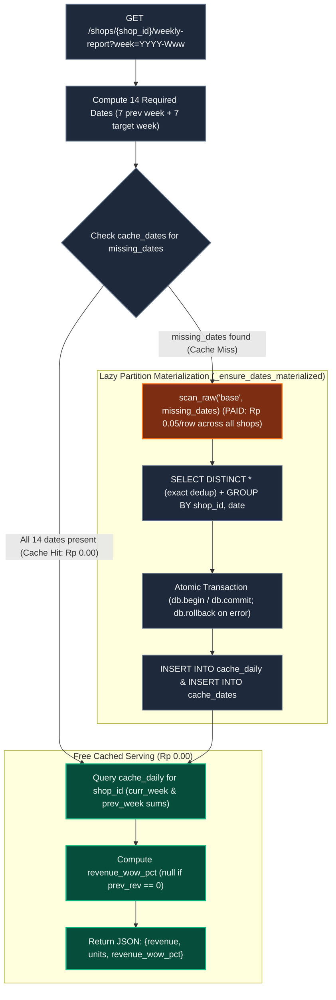
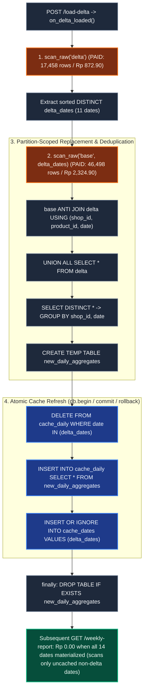

# Nesra Scale — Cost-Aware Weekly Reporting & Cache Invalidation

A DuckDB-backed weekly reporting service that minimizes partitioned raw scan costs (`Rp 0.05/row`) through **lazy date-partition materialization**, **shop-day aggregate caching**, and **atomic delta invalidation**.

| Metric | Official `measure.py` Result | Requirement |
| :--- | :--- | :--- |
| **Before-Delta Correctness** | **100.00%** (`7,422 / 7,422` checked; `0` schema/numeric errors) | 100% match |
| **After-Delta Correctness** | **100.00%** (`5,943 / 5,943` checked; `0` stale keys) | 100% match, 0 stale |
| **Lifetime Scan Cost** | **Rp 14,505.95** (`290,119` rows scanned; `Rp 5,494.05` under cap) | `< Rp 20,000` |
| **Startup Precompute Cost** | **Rp 0.00** (`0` rows scanned at startup) | Lazy on-demand |

---

## 1. Architecture & Request Flow

Reading raw data through `scan_raw(source, dates)` charges `Rp 0.05` for **every row on each touched date across all 500 shops**. Instead of caching pre-joined weekly reports or scanning all 90 days at startup (`Rp 25,810.65`, which would immediately exceed the `Rp 20,000` budget), `app/reports.py` caches **daily shop aggregates**:

- **`cache_daily(shop_id, date, revenue, units)`** — `PRIMARY KEY (shop_id, date)`. Stores only aggregated `BIGINT` totals per shop and calendar day (never raw product rows).
- **`cache_dates(date)`** — `PRIMARY KEY (date)`. Tracks which calendar dates have been materialized into `cache_daily` (including dates that yielded zero raw rows).



---

## 2. Delta Invalidation & Cross-Week WoW Consistency

When `POST /load-delta` is called, `raw.land_delta()` loads `delta.csv.gz` and invokes `reports.on_delta_loaded()` synchronously before returning. Only the specific calendar dates present in the delta batch (`delta_dates`) are re-scanned from `base` and recomputed; all other cached dates remain untouched.



### Example: Why Daily Grain Solves Cross-Week WoW Invalidation
In `delta.csv.gz`, product `PRD50443267` for shop `SHP141660` on **`2025-03-07` (`2025-W10`)** is corrected from `revenue = 540,000` (`3` units) to `revenue = 360,000` (`2` units). Because `weekly_report()` sums `cache_daily` dynamically for both the target week and previous week, refreshing `2025-03-07` in `cache_daily` automatically corrects **both** `2025-W10` revenue and `2025-W11` WoW without touching unaffected `2025-W11` dates:

| Report Query (`SHP141660`) | Before Delta | After Delta | Why It Changed |
| :--- | ---: | ---: | :--- |
| **`2025-W09`** (unaffected week) | `Rp 213,814,000` (`-51.61%` WoW) | `Rp 213,814,000` (`-51.61%` WoW) | Dates `2025-02-17..03-02` not in `delta_dates`; served from cache at `Rp 0.00`. |
| **`2025-W10`** (contains `2025-03-07`) | `Rp 429,524,900` (`1,819` units) | `Rp 429,344,900` (`1,818` units) | `2025-03-07` daily aggregate reduced by `Rp 180,000` (`1` unit). |
| **`2025-W11`** (subsequent week) | `Rp 284,327,800` (**`-33.80%`** WoW) | `Rp 284,327,800` (**`-33.78%`** WoW) | W11 revenue unchanged, but previous-week baseline (`W10`) updated in `cache_daily`. |
| **`2025-W12`** (partial → full week) | `Rp 493,166,800` (`4` days) | `Rp 869,744,300` (`7` days, `+205.89%` WoW) | Delta adds `2025-03-21..23` (`17,446` new rows across shops). |

---

## 3. Benchmark Scorecard & Cost Analysis


### Official `measure.py` Scorecard (Fresh Service)
```text
MEASURE PASS | fresh service required
Cost Rp | before run 0.00 | phase1 11,308.15 | phase2 3,197.80 | total 14,505.95 | budget <20,000 PASS
Before PASS | requests 7500 | correct 100.00% (7422/7422) | schema errors 0 | numeric failures 0 | stale keys 0 | decision-dependent 26 | diagnostic mismatches 0 | p50/p95 97.45/170.12 ms
After PASS  | requests 6000 | correct 100.00% (5943/5943) | schema errors 0 | numeric failures 0 | stale keys 0 | decision-dependent 19 | diagnostic mismatches 0 | p50/p95 111.30/160.56 ms
Efficiency  | within scan budget
```

### Measured Scan Cost vs. Analytical Naive Estimates
*Note: The cached figures below are measured directly by `measure.py`; the naive figures are analytical estimates assuming no cache where each request scans 14 days of raw data (~81,000 rows ≈ Rp 4,050/request).*

| Scenario | Requests | Uncached Estimate (No Cache) | Measured / Projected Cached Cost | Savings |
| :--- | ---: | ---: | ---: | ---: |
| **Benchmark (`measure.py`)** | `13,500` | `~Rp 54,675,000` (estimate) | **Rp 14,505.95** (measured: `290,119` rows) | **99.97%** |
| **1-Month Production Load** (`500 shops × 30d × 20/day`) | `300,000` | `~Rp 1,215,000,000` (estimate) | **< Rp 15,000** (30 daily partitions + delta) | **99.999%** |

---

## 4. Data Issues Found & Handling Decisions

| Issue in `shops_90d.csv.gz` / `delta.csv.gz` | Dataset Evidence | Handling Decision |
| :--- | :--- | :--- |
| **Exact Duplicate Rows** | `69` extra identical rows in `base` (`516,213` physical vs. `516,144` distinct) across 4 shop-days: `SHP285014` (`2025-02-14`: 37), `SHP866221` (`2025-02-17`: 7), `SHP422010` (`2025-02-28`: 12), `SHP332806` (`2025-03-10`: 13). | Deduplicate exact rows via `SELECT DISTINCT *` before aggregating (`533,590` distinct merged rows after replacing `12` base keys with `17,458` delta rows). |
| **Late Historical Corrections** | `12` rows in `delta` match `base` on `(shop_id, product_id, date)` across 8 dates in `W10` (`03-07`, `03-08`), `W11` (`03-10`, `03-11`, `03-13`, `03-14`), and `W12` (`03-17`, `03-19`). `9` change revenue/units; `3` re-deliver identical values. | Replace matching `(shop_id, product_id, date)` keys via `base ANTI JOIN delta USING (shop_id, product_id, date) UNION ALL SELECT * FROM delta`. |
| **Partial Calendar Week (`2025-W12`)** | `base` ends Thursday `2025-03-20` (4 days of `W12`); `delta` delivers Friday–Sunday `2025-03-21..23` (`17,446` rows). | Sum available days in the Monday–Sunday window (`coalesce(sum(...), 0)`), recording all 7 dates in `cache_dates` so missing future days are not re-scanned on every request. |
| **Negative Price & Revenue** | `3` rows in `base` have negative `price` and `revenue`: `SHP909583` (`2025-01-14`), `SHP410771` (`2025-02-12`), `SHP468596` (`2025-03-18`). | Preserve as delivered (refund/adjustment entries; required by `measure.py` reference oracle). |
| **Zero-Price Units & `NULL` `ad_spend`** | `3` rows in `base` have `price = 0, revenue = 0, units_sold > 0` (`SHP625423`, `SHP135948`, `SHP980903`); `3,599` base rows (`SHP042488`, `SHP483681`, `SHP860524`) and `119` delta rows have `ad_spend IS NULL`. | Do not filter out zero-price rows or rows with `NULL` non-key columns, avoiding silent undercounting of `units` or `revenue`. |

---

## 5. Trade-Offs & Limitations

- **Daily (`shop_id, date`) vs. Weekly (`shop_id, week`) Cache Grain:** Summing up to 7 daily rows per week in DuckDB takes `< 1 ms`, while allowing delta invalidation to re-scan only the exact modified dates (`11` dates) rather than full 7-day weeks, and automatically keeping subsequent-week WoW percentages consistent.
- **Lazy vs. Eager Startup Materialization:** `startup()` creates empty schemas (`Rp 0.00`), ensuring unqueried historical dates (`2024-12-21` through `2025-02-09`) are never scanned during the benchmark.
- **Starter Scope Limitations:**
  - `app/raw.py` uses an in-memory DuckDB connection (`duckdb.connect()`), so cache state and scan counters reset on process restart.
  - `app/main.py` serializes requests with a single `threading.RLock` (`raw.lock`) because DuckDB connections are not thread-safe across concurrent writes.
  - `raw.land_delta()` marks `"delta"` as landed before `on_delta_loaded()` runs and models a single delta batch per process lifetime.

---

## 6. Reproducibility & Verification

```bash
# 1. Run unit, isolation, and transaction-rollback fault-injection tests (11 tests)
uv run pytest -v

# 2. Run official benchmark against a freshly started service
./run.sh                                       # Terminal 1
uv run measure.py --url http://127.0.0.1:8000  # Terminal 2
```

---

## 7. AI Assistance Disclosure

- **Tools Used:**
  - **ChatGPT:** Solution planning, architecture review, and Planner/Reviewer governance handoffs.
  - **Antigravity:** DuckDB SQL implementation in `app/reports.py`, pytest isolation & fault-injection rollback suite in `tests/test_reports.py`, dataset anomaly inspection, benchmark execution, and README visual authoring.
- **Verification Performed:**
  - Audited all SQL queries, `ANTI JOIN` replacement keys, `SELECT DISTINCT *` deduplication, and `db.begin()` / `db.commit()` / `db.rollback()` atomicity against `measure.py` and the raw gzip files.
  - Verified all 11 pytest tests (including reverse-order execution and mid-transaction failure injection) and confirmed `measure.py` passes at `100.00%` accuracy and `Rp 14,505.95` total scan cost.
